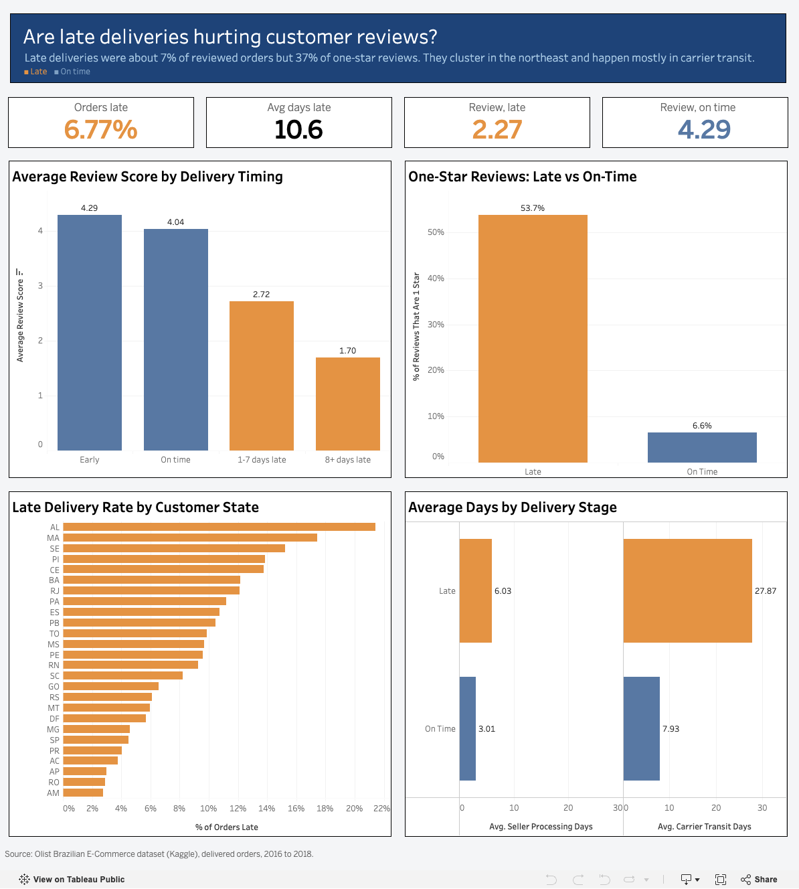

# Are Late Deliveries Hurting Customer Reviews?

A delivery-performance analysis of a Brazilian e-commerce marketplace (about 96,000 delivered orders, 2016 to 2018).

**Live dashboard:** [View on Tableau Public](https://public.tableau.com/app/profile/tyler.greenwell/viz/olist_delivery_analysis/Dashboard1)



## Summary

Late deliveries were about 6.7% of reviewed orders but produced about 37% of all one-star reviews. Late rates were highest in northeastern states (15% to 21%) and lowest in the southeast (about 4% to 5%). Late orders spent about 20 more days in carrier transit than on-time orders but only about 3 more days with the seller, so the delay shows up mainly in the carrier leg, not in seller processing, product category, or product weight.

## The question

Are late deliveries costing the marketplace in customer reviews, and where should it focus first to fix them?

## Data

- Olist Brazilian E-Commerce Public Dataset from Kaggle: https://www.kaggle.com/datasets/olistbr/brazilian-ecommerce
- Nine related tables (orders, order items, reviews, customers, sellers, products, and others), loaded into PostgreSQL.
- Orders run from September 2016 to August 2018, so findings describe that period and may not reflect current operations.
- An order counts as late when it was delivered after its estimated delivery date.

## Method

- Loaded the nine CSVs into PostgreSQL with a Python script (`load_data.py`), converting date columns on load.
- Ran data-quality checks in SQL and logged every decision (see `notes/`).
- Built a `delivery_performance` view that labels each delivered order late or on time and records how many days early or late it was.
- Measured how big the problem is, tested possible drivers (sellers, state, category, weight, delivery stage), and measured the cost in reviews and repeat purchases.
- Built the dashboard in Tableau from a single flat extract.

## Data-quality decisions

- 99,441 orders in total. Analysis uses delivered orders with a delivery date: 96,470.
- 8 orders marked delivered had no delivery date and were excluded.
- Some orders had more than one review with different scores. I averaged them per order.
- 768 orders had no review. They stay in delivery-rate calculations and are excluded from review analysis.
- 1,392 delivered orders contain products with no category name. They are excluded from the category analysis only.
- The monthly trend starts in January 2017 because the 2016 months have too few orders for reliable rates.

## Key findings

- **How often orders are late:** 6.77% of delivered orders arrive late, by 10.6 days on average. The rate was about 3% for much of early 2017, then spiked to 12.4% in November 2017 and 19.0% in March 2018 before falling back.
- **Reviews fall as soon as an order is late:** late orders average 2.27 stars versus 4.29 for on-time orders. Early orders average 4.29, on-time 4.04, 1 to 7 days late 2.72, and 8 or more days late about 1.70.
- **One-star reviews:** 53.7% of late orders get a one-star review versus 6.6% of on-time orders. Late orders were 6.7% of reviewed orders but 36.8% of all one-star reviews (3,426 of 9,312).
- **Geography is the strongest driver:** late rates were 21.4% in Alagoas, 17.4% in Maranhao, and 15.2% in Sergipe, compared with about 4% to 5% in Sao Paulo, Parana, and Minas Gerais. States with higher late rates also had lower average review scores. Rio de Janeiro (about 12%) is a large state with a high rate that does not fit a simple north-versus-south pattern.
- **What did not explain lateness:** no small group of sellers stood out, product category only moved the late rate between about 7% and 12%, and product weight only between about 6% and 8%.
- **Where the delay occurs:** late orders averaged 27.9 days in carrier transit versus 7.9 for on-time orders, and 6.0 days of seller processing versus 3.0.
- **Repeat purchases:** customers whose first order was late came back at 2.55% versus 3.03% for customers whose first order was on time. The direction fits the hypothesis, but the gap is small and only about 3% of customers ordered more than once, so this is not a strong result.

## Recommendation

Look first at carrier performance on long-distance routes to the northeast, starting with AL, MA, SE, PI, and CE. Two things worth testing:

- Why carrier transit to those states takes so much longer for late orders.
- Whether estimated delivery dates for those regions are realistic. If they are not, setting them more accurately could reduce the one-star reviews that late orders produce.

## What this analysis cannot answer

- **Cause.** I found a strong association between lateness and low reviews. There is no controlled test, so I cannot say lateness alone causes the low scores. The review is written after delivery, which rules out the reverse direction.
- **Why carriers are slower.** The data shows where the extra days occur, not why. Distance is a plausible explanation given the state pattern, but I did not measure distance directly.
- **Today's performance.** The data covers 2016 to 2018 only.
- **Retention.** Too few customers placed a second order to draw strong conclusions.

## Repository structure

```
load_data.py        loads the CSVs into PostgreSQL
sql/                 01_quality_checks to 06_dashboard_view, run in order
notes/               data-quality decisions
dashboard/           Tableau workbook and screenshot
```

## How to reproduce

1. Download the dataset from Kaggle and place the CSVs in `data/`.
2. Create the environment: `python3 -m venv venv`, `source venv/bin/activate`, `pip install pandas sqlalchemy psycopg2-binary`.
3. Create a PostgreSQL database named `olist`, then run `python3 load_data.py`.
4. Run the SQL files in `sql/` in numeric order with `psql -U postgres -d olist -f sql/<file>.sql`.

## Tools

PostgreSQL, SQL, Python (pandas, SQLAlchemy), Tableau
